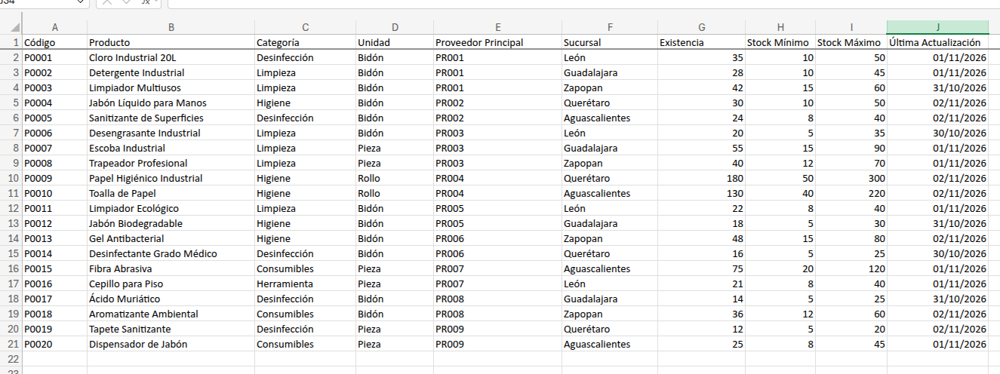
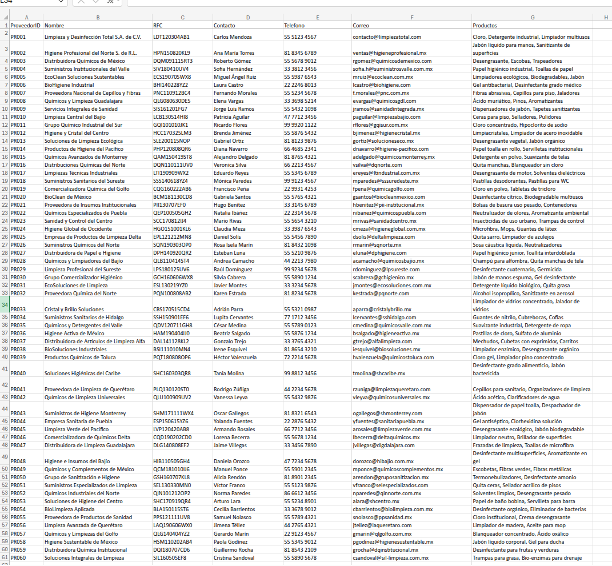

# Proyecto AI-901 – Río Claro
# Preparación de Datos para la Implementación de Inteligencia Artificial

## Objetivo

Preparar y organizar la información crítica de Río Claro para permitir la incorporación gradual de herramientas de Inteligencia Artificial, garantizando que la operación comercial continúe funcionando mientras se mejora la calidad y centralización de los datos.

---

# Estado Actual del Repositorio

Se creó una estructura inicial en SharePoint para centralizar la información asociada al proyecto.

```text
RioClaro-AI901
│
├── Facturas
├── FAQ
├── Inventarios
├── Politicas
└── Proveedores
```

## Objetivo de la Estructura

Cada carpeta representa una futura fuente de información que será utilizada por herramientas de búsqueda inteligente y agentes de IA.

| Carpeta | Propósito |
|----------|------------|
| Facturas | Almacenamiento de facturas PDF e imágenes |
| FAQ | Preguntas frecuentes para entrenamiento del agente |
| Inventarios | Control centralizado de productos |
| Politicas | Procedimientos y políticas corporativas |
| Proveedores | Información de proveedores y suministros |

---

# Entregable 1 – Inventario Maestro

## Objetivo

Crear una fuente única de verdad para todos los productos comercializados por Río Claro.

---

## Actividades Realizadas

### Normalización de Catálogo

Se identificaron nombres inconsistentes y se definió un catálogo estandarizado.

Ejemplo:

Antes:

```text
CLORO INDUSTRIAL
CLORO BIDÓN
CLORO 20L
```

Después:

```text
P0001 - Cloro Industrial 20L
```

---

### Diseño de la Estructura

Actualmente el archivo contiene:

```text
Código
Producto
Categoría
Unidad
Proveedor Principal
Sucursal
Existencia
Stock Mínimo
Stock Máximo
Última Actualización
```

---

### Productos Registrados

Actualmente existen productos relacionados con:

- Desinfección
- Limpieza
- Higiene
- Herramientas
- Consumibles

Ejemplos:

```text
P0001 - Cloro Industrial 20L
P0002 - Detergente Industrial
P0004 - Jabón Líquido para Manos
P0009 - Papel Higiénico Industrial
P0014 - Desinfectante Grado Médico
P0020 - Dispensador de Jabón
```

---

## Beneficios Obtenidos

- Eliminación de productos duplicados.
- Catálogo consistente entre sucursales.
- Base para búsqueda e inventarios inteligentes.
- Preparación para consultas mediante IA.

---

## Evidencia

### Inventario Maestro



https://redporlaciberseguridad-my.sharepoint.com/:x:/g/personal/icmcastroe-ia_labmx_ai/IQA2dCXEYGFYT6iZ7cJMG5U6Af7C2YBaUHz1AjDPqH802Qs?e=hORkfI 


```text
Ruta:
Inventarios/InventarioMaestro.xlsx
```

---

# Entregable 2 – Catálogo Centralizado de Proveedores

## Objetivo

Concentrar la información de todos los proveedores en un único repositorio.

---

## Estructura Definida

El archivo contiene:

```text
ProveedorID
Nombre
RFC
Contacto
Teléfono
Correo
Productos
```

---

## Información Disponible

Actualmente se encuentran registrados proveedores especializados en:

- Productos químicos
- Productos de limpieza
- Higiene industrial
- Consumibles
- Equipamiento para limpieza

Ejemplos:

```text
PR001
Limpieza y Desinfección Total S.A. de C.V.

PR002
Higiene Profesional del Norte

PR003
Distribuidora Químicos de México
```

---

## Beneficios Obtenidos

- Relación directa entre productos y proveedores.
- Reducción del tiempo de búsqueda.
- Preparación para consultas inteligentes.
- Base para análisis de abastecimiento.

---

## Evidencia

### Catálogo de Proveedores



https://redporlaciberseguridad-my.sharepoint.com/:x:/g/personal/icmcastroe-ia_labmx_ai/IQD1GCTkAsRVTJsc_ZAncPYkAQo-N0FoBaLiyhYzkTrDnXA?e=8orblp 

```text
Ruta:
Proveedores/Proveedores.xlsx
```

---

# Entregable 3 – Relación Producto-Proveedor

## Objetivo

Garantizar trazabilidad entre inventario y suministro.

---

## Situación Actual

Cada producto se encuentra asociado a un proveedor principal.

Ejemplo:

| Producto | Proveedor |
|----------|-----------|
| Cloro Industrial 20L | PR001 |
| Detergente Industrial | PR001 |
| Jabón Líquido para Manos | PR002 |
| Desengrasante Industrial | PR003 |
| Papel Higiénico Industrial | PR004 |

---

## Beneficios

Permite responder preguntas como:

```text
¿Quién suministra Cloro Industrial?

¿Qué proveedor vende productos de desinfección?

¿Cuáles productos dependen del proveedor PR001?
```

Estas consultas serán utilizadas posteriormente por Azure AI Search y los agentes de IA.

---

## Evidencia

### Relación Producto-Proveedor

> Insertar captura donde se observe la columna "Proveedor Principal" del Inventario Maestro.

---

# Entregable 4 – Repositorio Documental Inicial

## Objetivo

Preparar la estructura documental que será utilizada posteriormente por los servicios de IA.

---

## Estado Actual

Actualmente se encuentran creadas las siguientes bibliotecas:

```text
Facturas
FAQ
Inventarios
Politicas
Proveedores
```

---

## Estrategia de Crecimiento

### Facturas

Contendrá:

```text
PDF
Imágenes JPG
Imágenes PNG
```

Posteriormente será procesada mediante:

```text
Azure AI Document Intelligence
```

---

### Inventarios

Contiene:

```text
InventarioMaestro.xlsx
```

Será utilizado para:

```text
Consultas de stock
Consultas de sucursal
Consultas de productos
```

---

### Proveedores

Contiene:

```text
Proveedores.xlsx
```

Será utilizado para:

```text
Consultas de abastecimiento
Relaciones producto-proveedor
```

---

### FAQ

Se utilizará para almacenar:

```text
Preguntas frecuentes
Respuestas estándar
Información comercial
```

---

### Politicas

Se utilizará para almacenar:

```text
Políticas internas
Procedimientos
Normativas operativas
```

---

## Beneficios de la Estructura

- Información centralizada.
- Fácil administración.
- Crecimiento gradual.
- Compatible con Azure AI Search.
- Compatible con Microsoft AI Foundry.

---

# Preparación para la Siguiente Fase

Con los entregables actuales se cuenta con la base mínima necesaria para comenzar la implementación técnica del proyecto.

---

## Completado

✅ Repositorio SharePoint

✅ Inventario Maestro

✅ Catálogo de Proveedores

✅ Relación Producto-Proveedor

✅ Estructura Documental Inicial

---

## Próxima Fase

Implementación de servicios de Inteligencia Artificial:

```text
Azure AI Foundry

Azure AI Search

Azure AI Document Intelligence

Modelo GPT para consultas

Agente Inteligente Empresarial
```

---

# Conclusión

La organización de la información representa el primer paso hacia la adopción de Inteligencia Artificial en Río Claro. Antes de implementar agentes conversacionales o modelos generativos, fue necesario construir una base de datos consistente de productos y proveedores, así como una estructura documental centralizada.

Este enfoque permite mantener la operación diaria de la empresa, minimizar riesgos y garantizar que las futuras respuestas generadas por IA utilicen información confiable y verificable.