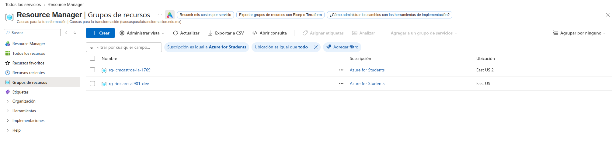
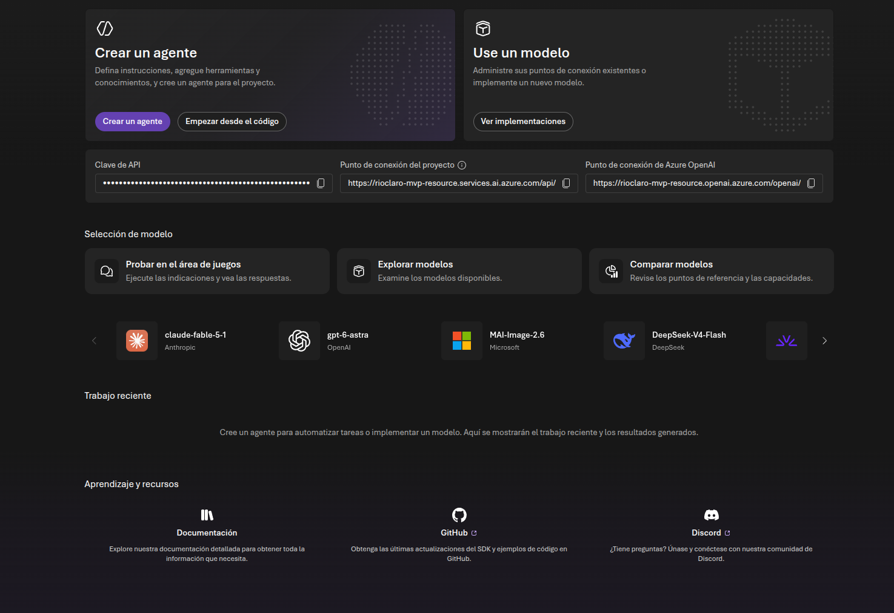

# Proyecto AI-901 – Río Claro

# Fase 4 – Implementación de Infraestructura Base

## Objetivo

Construir la infraestructura inicial en Microsoft Azure necesaria para soportar las futuras capacidades de Inteligencia Artificial del proyecto Río Claro.

---

# Análisis de la Fase

Hasta este punto del proyecto se completaron las siguientes actividades:

✅ Análisis de procesos actuales.

✅ Identificación de problemas operativos.

✅ Construcción del Inventario Maestro.

✅ Consolidación del Catálogo de Proveedores.

✅ Creación del repositorio documental en SharePoint.

La información ya se encuentra organizada, sin embargo aún no existe una plataforma que permita utilizar Inteligencia Artificial sobre esos datos.

Por esta razón se requiere implementar la primera capa tecnológica en Azure.

---

# Arquitectura Inicial del MVP

```text
Documentos
(SharePoint)
        │
        ▼
 Azure AI Search
        │
        ▼
 Azure AI Foundry
        │
        ▼
 Agente Inteligente
```

Durante esta fase únicamente se construye la infraestructura necesaria para soportar las siguientes etapas.

Todavía no existe un chatbot funcional ni procesamiento de documentos automáticos.

---

# Implementación Realizada

## Paso 1. Creación del Grupo de Recursos

### Objetivo

Centralizar todos los recursos del proyecto en una única ubicación administrativa.

### Configuración

```text
Nombre:
rg-rioclaro-ai901-dev

Suscripción:
Azure for Students

Región:
East US
```

### Justificación

El Grupo de Recursos permitirá administrar todos los componentes relacionados con Río Claro desde un único punto.

Ejemplos de recursos futuros:

```text
Azure AI Foundry
Azure AI Search
Azure AI Document Intelligence
Storage Accounts
```

---

## Evidencia

### Grupo de Recursos Creado



```text
Evidencias/01-ResourceGroup.png
```

---

# Paso 2. Creación del Proyecto de Azure AI Foundry

## Objetivo

Crear el espacio de trabajo principal para el desarrollo de soluciones de Inteligencia Artificial.

---

## Configuración

### Nombre del Proyecto

```text
RioClaro-MVP
```

### Recurso Principal

```text
RioClaro-MVP-resource
```

### Grupo de Recursos

```text
rg-rioclaro-ai901-dev
```

### Suscripción

```text
Azure for Students
```

---

## Propósito del Proyecto

Este proyecto será utilizado para administrar:

- Modelos de Inteligencia Artificial.
- Conexiones a servicios Azure.
- Agentes Inteligentes.
- Herramientas de búsqueda.
- Bases de conocimiento empresariales.

---

## Justificación

La empresa Río Claro necesita una plataforma central capaz de integrar inventarios, proveedores, políticas y facturas sin afectar la operación actual.

Azure AI Foundry proporciona un entorno unificado para administrar dichas capacidades.

---

## Beneficios Esperados

### Para Inventarios

Consultas futuras como:

```text
¿Cuánto inventario existe de Cloro Industrial 20L?
```

---

### Para Proveedores

Consultas futuras como:

```text
¿Quién suministra Desengrasante Industrial?
```

---

### Para Políticas

Consultas futuras como:

```text
¿Cuál es la política de devoluciones?
```

---

## Evidencia

### Creación del Proyecto



```text
Evidencias/02-RioClaroMVP-Creado.png
```

---

# Estado del Proyecto

## Completado

✅ Inventario Maestro

✅ Catálogo de Proveedores

✅ Repositorio Documental

✅ Grupo de Recursos Azure

✅ Proyecto Azure AI Foundry

---

# Próxima Actividad

## Azure AI Search

En la siguiente fase se implementará Azure AI Search para permitir que la Inteligencia Artificial pueda localizar información dentro de:

```text
Inventarios
Proveedores
FAQ
Políticas
Facturas
```

Esto permitirá construir posteriormente una solución de búsqueda inteligente basada en RAG (Retrieval Augmented Generation).

---

# Conclusión

La creación del Grupo de Recursos y del proyecto RioClaro-MVP representa la primera implementación técnica del proyecto. A partir de este punto se dispone de una plataforma escalable para incorporar capacidades de búsqueda inteligente, procesamiento documental y agentes de IA que apoyen las operaciones de Río Claro sin reemplazar la supervisión humana.