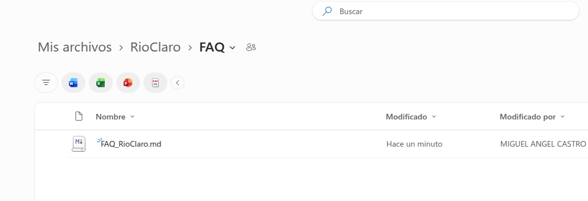
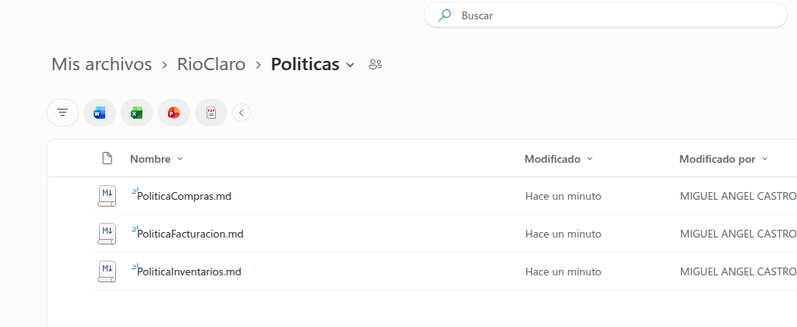

# Proyecto AI-901 – Río Claro

# Fase 5 – Construcción de la Base de Conocimiento

## Objetivo

Preparar la información empresarial para ser utilizada por herramientas de Inteligencia Artificial mediante una estructura documental organizada y fácil de consultar.

---

# Análisis

Durante las fases anteriores se logró:

✅ Inventario Maestro

✅ Catálogo de Proveedores

✅ Repositorio Documental

✅ Infraestructura inicial en Azure

Sin embargo, la Inteligencia Artificial requiere información estructurada y contextual para generar respuestas confiables.

Por esta razón se construye una Base de Conocimiento Empresarial.

---

# Estructura Documental

## SharePoint

```text
RioClaro-AI901
│
├── Facturas
├── FAQ
│   └── FAQ_RioClaro.md
├── Inventarios
│   └── InventarioMaestro.xlsx
├── Politicas
│   ├── PoliticaInventarios.md
│   ├── PoliticaCompras.md
│   └── PoliticaFacturacion.md
└── Proveedores
    └── Proveedores.xlsx
```

---

# Componentes de la Base de Conocimiento

## FAQ

Contiene respuestas rápidas a preguntas frecuentes relacionadas con:

- Inventarios
- Proveedores
- Facturación
- Inteligencia Artificial

---

## Políticas

Contiene lineamientos oficiales de operación.

### Política de Inventarios

Define:

- Actualización de existencias
- Stock mínimo
- Control de productos

### Política de Compras

Define:

- Relación con proveedores
- Reabastecimiento
- Selección de proveedores

### Política de Facturación

Define:

- Recepción
- Registro
- Validación de facturas

---

# Beneficios

La Base de Conocimiento permitirá que los futuros agentes de IA respondan preguntas como:

```text
¿Qué sucede cuando un producto llega al stock mínimo?
```

```text
¿Quién puede aprobar una compra?
```

```text
¿Cómo se registran las facturas?
```

```text
¿La IA aprueba facturas automáticamente?
```

---

# Evidencias

## FAQ



```text
Evidencias/03-FAQ.png
```

---


## Política de Inventarios
```text
Evidencias/04-PoliticaInventarios.png
```
## Política de Compras

```text
Evidencias/05-PoliticaCompras.png
```
## Política de Facturación
```text
Evidencias/06-PoliticaFacturacion.png
```

---

# Resultado Esperado

Al finalizar esta fase, Río Claro contará con una Base de Conocimiento preparada para ser indexada por Azure AI Search.

Esta información servirá como fuente oficial para los futuros agentes de Inteligencia Artificial, garantizando respuestas consistentes, trazables y alineadas con los procedimientos de la organización.

---

# Próxima Fase

Fase 6 – Configuración de Azure AI Search e Indexación Documental.

Durante la siguiente fase se conectará Azure AI Search con la información almacenada en SharePoint para habilitar búsquedas inteligentes sobre inventarios, proveedores, FAQ y políticas.