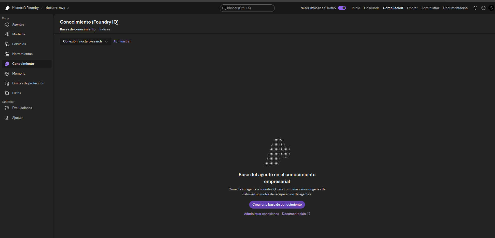
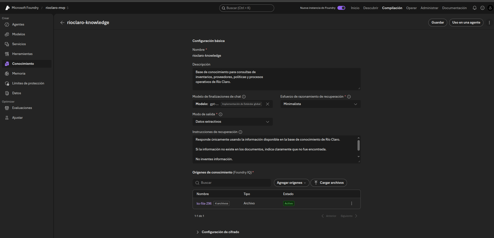

# Proyecto AI-901 – Río Claro

# Fase 6 – Construcción de la Base de Conocimiento

## Objetivo

Construir la primera Base de Conocimiento Empresarial de Río Claro utilizando Azure AI Foundry y Azure AI Search, permitiendo que futuros agentes de Inteligencia Artificial puedan consultar información corporativa de manera controlada y basada en documentos oficiales.

---

# Análisis de la Fase

Durante las fases anteriores se construyó la base documental necesaria para el proyecto.

Actualmente la empresa cuenta con:

✅ Inventario Maestro

✅ Catálogo de Proveedores

✅ Repositorio documental en SharePoint

✅ Azure AI Foundry

✅ Azure AI Search

✅ Integración entre Azure AI Foundry y Azure AI Search

Sin embargo, la información aún no puede ser utilizada directamente por un agente de Inteligencia Artificial.

Para resolver esto se implementa una Base de Conocimiento que permitirá transformar documentos empresariales en información consultable mediante lenguaje natural.

---

# Arquitectura de Conocimiento

```text
Documentos Empresariales
        │
        ▼
Azure AI Foundry
        │
        ▼
Base de Conocimiento
        │
        ▼
Azure AI Search
        │
        ▼
Recuperación de Información
        │
        ▼
Agente Inteligente
```

---

# Diseño de la Base de Conocimiento

## Nombre

```text
rioclaro-knowledge
```

---

## Objetivo

Centralizar y organizar la información operativa utilizada por Río Claro para consultas futuras mediante agentes inteligentes.

---

## Descripción

```text
Base de conocimiento para consultas inteligentes sobre
inventarios, proveedores, políticas operativas y
procedimientos internos de Río Claro.
```

---

# Configuración Realizada

## Proyecto Asociado

```text
rioclaro-mvp
```

---

## Motor de Búsqueda Asociado

```text
rioclaro-search
```

---

## Esfuerzo de Recuperación

```text
Minimalista
```

### Justificación

Debido a que el proyecto corresponde a un piloto académico y utiliza una cantidad reducida de documentos, un nivel de recuperación básico resulta suficiente para obtener respuestas relevantes.

---

## Modo de Salida

```text
Datos extractivos
```

### Justificación

Se seleccionó este modo para priorizar respuestas basadas en información existente dentro de los documentos y reducir la posibilidad de generar contenido no respaldado por las fuentes documentales.

---

# Documentos Incorporados

Para la primera versión de la Base de Conocimiento se utilizaron documentos estructurados en formato Markdown.

---

## FAQ Empresarial

Archivo:

```text
FAQ_RioClaro.md
```

Contenido:

- Inventarios
- Proveedores
- Facturación
- Uso de Inteligencia Artificial
- Responsabilidades operativas

---

## Política de Inventarios

Archivo:

```text
PoliticaInventarios.md
```

Contenido:

- Gestión de existencias
- Control de productos
- Actualización de inventario
- Stock mínimo
- Stock máximo

---

## Política de Compras

Archivo:

```text
PoliticaCompras.md
```

Contenido:

- Proceso de abastecimiento
- Selección de proveedores
- Solicitudes de compra
- Responsabilidades administrativas

---

## Política de Facturación

Archivo:

```text
PoliticaFacturacion.md
```

Contenido:

- Recepción de facturas
- Registro documental
- Validación de información
- Uso de IA para extracción de datos

---

# Fuentes Documentales Utilizadas

```text
RioClaro-AI901
│
├── FAQ
│   └── FAQ_RioClaro.md
│
├── Politicas
│   ├── PoliticaInventarios.md
│   ├── PoliticaCompras.md
│   └── PoliticaFacturacion.md
```

---

# Configuración de Recuperación

Se configuró la siguiente instrucción para controlar el comportamiento de la recuperación de información:

```text
Responde únicamente utilizando información
existente dentro de la Base de Conocimiento
de Río Claro.

Si la información solicitada no existe
en los documentos disponibles,
indica claramente que no fue encontrada.

No inventes información.

Prioriza las políticas para consultas
relacionadas con procedimientos internos.
```

---

# Beneficios Obtenidos

## Centralización del Conocimiento

Toda la información relevante comienza a almacenarse en una única fuente consultable.

---

## Preparación para RAG

La Base de Conocimiento constituye el primer paso hacia una arquitectura basada en:

```text
Retrieval Augmented Generation (RAG)
```

donde las respuestas serán construidas utilizando información real de la organización.

---

## Reducción de Alucinaciones

El uso de documentos corporativos como fuente principal reduce la posibilidad de respuestas incorrectas o inventadas.

---

# Casos de Uso Esperados

Una vez conectada a un Agente Inteligente, la Base de Conocimiento podrá responder preguntas similares a:

```text
¿Qué sucede cuando un producto llega al stock mínimo?
```

---

```text
¿La IA aprueba facturas automáticamente?
```

---

```text
¿Quién puede actualizar un inventario?
```

---

```text
¿Cómo deben registrarse las facturas?
```

---

```text
¿Qué información contiene el catálogo de proveedores?
```

---

# Evidencias



## Azure AI Search Conectado
## Pantalla de Conocimiento
## Creación de Base de Conocimiento
## Documentos Cargados



---

# Resultado de la Fase

Al concluir esta fase se dispone de:

✅ Azure AI Search operativo

✅ Azure AI Search conectado a Azure AI Foundry

✅ Base de Conocimiento "rioclaro-knowledge"

✅ FAQ empresarial indexado

✅ Políticas empresariales indexadas

✅ Configuración inicial para arquitectura RAG

---

# Próxima Fase

## Fase 7 – Creación del Agente Inteligente Río Claro

Durante la siguiente fase se construirá un agente conversacional capaz de:

- Consultar la Base de Conocimiento.
- Recuperar información desde Azure AI Search.
- Responder preguntas en lenguaje natural.
- Mostrar información basada en documentos corporativos.
- Mantener supervisión humana sobre las decisiones de negocio.

---

# Conclusión

La Base de Conocimiento representa el primer componente funcional de Inteligencia Artificial dentro de Río Claro. Gracias a la integración entre Azure AI Search y Azure AI Foundry, la información previamente organizada en documentos empresariales puede transformarse en conocimiento consultable, estableciendo la base para la construcción de asistentes inteligentes y soluciones de búsqueda avanzada mediante IA generativa.